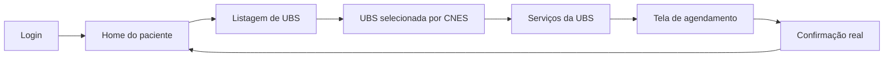

# Fluxo de usuário — MedScan

## Fluxo não autenticado

```mermaid
flowchart TD
    A[/" ou /home"] --> B{Escolha}
    B --> C[/login]
    B --> D[/cadastro]
    C -->|sucesso| E{Nível de acesso}
    E -->|Paciente| F[Home]
    E -->|Administrador| G[/admin]
    C -->|falha| C
    D --> H[Cadastro etapa 1]
    H --> I[Etapa 2]
    I --> J[Etapa 3]
    J --> K[Confirmação enviada]
    K --> C
```

## Cadastro

O cadastro público é exclusivo para paciente e usa `POST /paciente/pacienteCadastroCompleto`.
Os dados ficam em memória enquanto o usuário avança ou volta entre as três etapas. Cada etapa é validada antes do avanço; o login só é aberto após a resposta de sucesso do backend.

O payload do cadastro corresponde ao `PacienteCadastroCompletoRequest`: dados de usuário, dados pessoais e endereço. Identificadores de usuário e nível de acesso não são aceitos pelo formulário.
O formulário envia `nome`, `email`, `senha`, `cpf`, `dataNascimento`, `genero`, `logradouro`, `numero`, `bairro`, `cidade`, `uf`, `cep` e `complemento`.
Não há formulário administrativo de usuário no frontend oficial; portanto, nenhuma operação administrativa é apresentada como disponível.

## Fluxo do paciente



UBS e serviços são carregados pelos serviços existentes. A seleção é transportada pela navegação usando `location.state`; a tela de agendamento também revalida a UBS contra a listagem do backend. A confirmação só aparece após sucesso de `POST /agendamento/agendamentoNew`.

## Fluxo administrativo

```mermaid
flowchart TD
    L[Login] --> R{Nível de acesso}
    R -->|Administrador| A[/admin]
    A --> P[Páginas administrativas disponíveis]
```

O backend possui contratos administrativos, mas este frontend não contém páginas administrativas de usuários, níveis, doenças ou UBS. A rota `/admin` informa essa pendência sem inventar telas ou operações.

## Logout

O menu autenticado chama `POST /usuario/usuarioLogout`, limpa o estado do `AuthContext` e redireciona para `/login`. Rotas protegidas redirecionam sessões ausentes para o login.
Após o login, pacientes retornam à rota protegida originalmente solicitada, quando aplicável; administradores seguem para `/admin`.
Se uma requisição retornar HTTP 401, a sessão local também é limpa e o guard redireciona o usuário para o login.

## Mapa de rotas

| Rota | Acesso | Destino |
|---|---|---|
| `/` | Público | Home |
| `/home` | Público | Redireciona para `/` |
| `/login` | Público | Login |
| `/cadastro` | Público | Cadastro em três etapas |
| `/agendamento` | Paciente autenticado | Agendamento |
| `/admin` | Administrador | Área administrativa informativa |
| `/acesso-negado` | Sessão ativa sem área frontend correspondente | Mensagem de indisponibilidade |
| demais | Público | Redireciona para `/` |

Os redirecionamentos de `/home` e de rotas desconhecidas são feitos pelo React Router, sem páginas duplicadas.
As rotas antigas sem página oficial (`/welcome`, `/ubs` e `/sobre`) não são usadas pelos menus.
URLs não encontradas usam o caminho curinga e retornam à Home.
As rotas `/agendamento` e `/admin` não renderizam seu conteúdo sem sessão válida; o guard encaminha o usuário para `/login`.
O menu identifica os perfis `PACIENTE` e `ADMIN`; `ATENDENTE` e `ADMINISTRADOR` são reconhecidos, mas recebem apenas logout e a tela de indisponibilidade enquanto suas áreas não existirem no frontend.
O menu administrativo é condicional ao perfil `ADMIN` e não aparece para pacientes.
Respostas HTTP 403 exibem a mensagem de permissão do cliente HTTP e não são tratadas como sucesso.

## Gerenciamento de sessão

Ao iniciar a aplicação, o `AuthContext` consulta `/usuario/usuarioSession`. O estado fica disponível para menus e guards. O logout chama o endpoint real e limpa o estado; uma resposta HTTP 401 também invalida a sessão local.
Componentes acessam esse estado pelo hook compartilhado `useAuth`, sem duplicar consultas ou manter sessões paralelas.
O botão `Sair` só aparece quando existe perfil autenticado e executa o logout real antes de limpar o estado local.
Se uma chamada retornar HTTP 401, o estado também é invalidado automaticamente e a próxima avaliação do guard direciona ao login.

## Arquivos modificados

- `src/index.jsx`
- `src/App.jsx`
- `src/context/AuthContext.jsx`
- `src/components/routing/RouteGuards.jsx`
- `src/components/topbar/TopBar.jsx`
- `src/pages/login/Login.jsx`
- `src/components/topbar/TopBar.jsx`
- `src/pages/admin/AdminHome.jsx`
- `src/pages/admin/AdminHome.css`
- `FLUXO_USUARIO.md`

## Testes

- `npm run lint`
- `npm run build`

Os testes ponta a ponta dependem do backend e do MariaDB disponíveis.

## Pendências

- Não existem páginas frontend administrativas para consumir os contratos já existentes.
- A identificação do perfil usa a descrição de `nivelAcesso` retornada pelo backend; descrições não administrativas são tratadas como paciente.
- A sessão real e a persistência do agendamento ainda precisam ser testadas com banco ativo.
- FE-08: atendente e administrador são reconhecidos pelo perfil, mas ainda não possuem áreas frontend implementadas.
- FE-09.2: formulários administrativos de usuário dependem de telas oficiais e de um endpoint de edição existente.
- FE-05.1: falha de comunicação no login não autentica nem redireciona o usuário.
- FE-05.2: falha de comunicação no cadastro não confirma o cadastro nem redireciona para o login.
- FE-05.3: o frontend não persiste dados de negócio localmente nem usa JSON local como substituto do backend.
- FE-05.4: confirmação e retorno à Home ocorrem somente após resposta válida do endpoint de agendamento.


